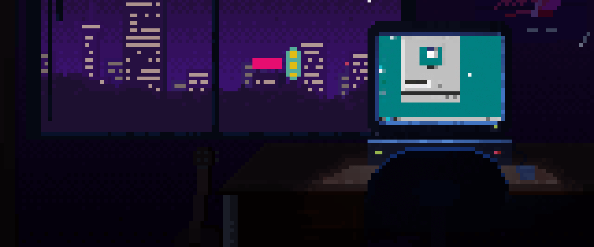

# 🖖 Hey dev! Welcome to my profile 

I'm a Computer Science Student & Data Engineering Enthusiast!

I've been diving into the tech world since 2022. While I started my journey in software engineering by exploring web and mobile app development, I eventually found my true calling behind the scenes: Data Engineering and Database Architecture.

What made me fall in love with the data world is the art of bringing order to complexity. For me, designing clean database schemas, optimizing complex SQL queries, and building reliable ETL/ELT pipelines feel like crafting the invisible backbone that powers modern applications. Transforming raw, scattered data into structured, scalable data warehouses is my version of blending logic with architectural precision.

As a Computer Science student and scholarship recipient, I’m constantly experimenting with Linux environments, Docker containerization, and relational databases. My goal is to deepen my expertise in data infrastructure and database administration, building resilient systems that drive impactful decisions.

## 👨🏻‍💻 About me

 

- 🌎 I'm from Indonesia
- 👨🏻‍💻 Love programming and gaming
- 🧠 Love sharing knowledge
- 🌌 Passionate for astronomy
- 📧 Reach me via maulidanfazri24@gmail.com

 
 
 
 
 

## 💻 Tech stack

  
  
  
  
  
  
  
  
  
  

---

 
  <i>Thanks for passing by</i>  
  <i>Feel free to connect with me</i>  
  <a href="https://www.linkedin.com/in/maulidanfazri/">
  <code></code>
</a>
<a href="https://instagram.com/maulidann._">
<code></code>
</a>

